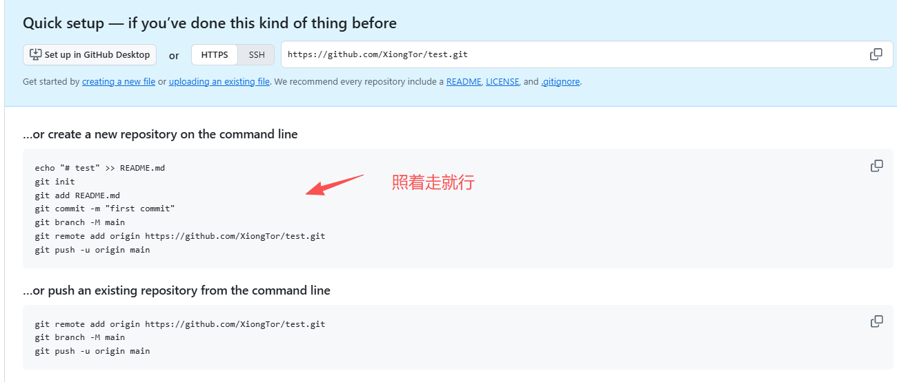
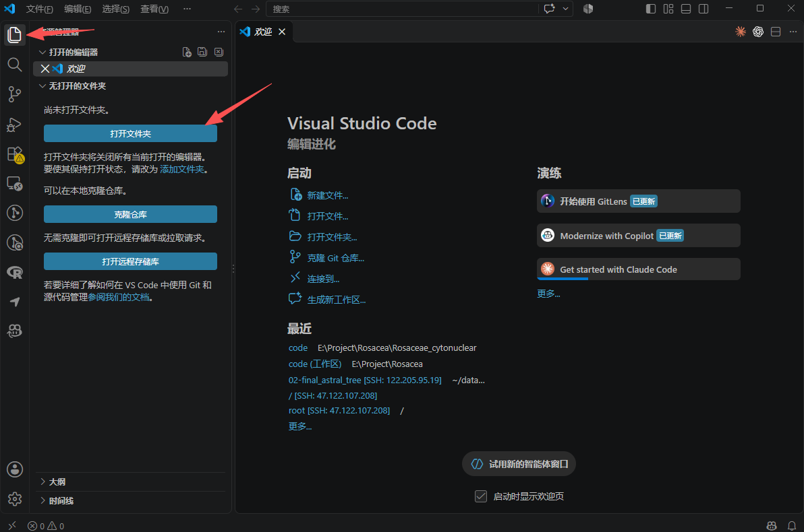
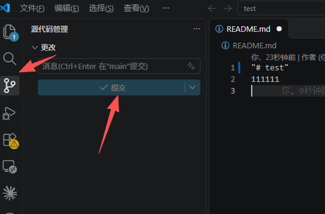
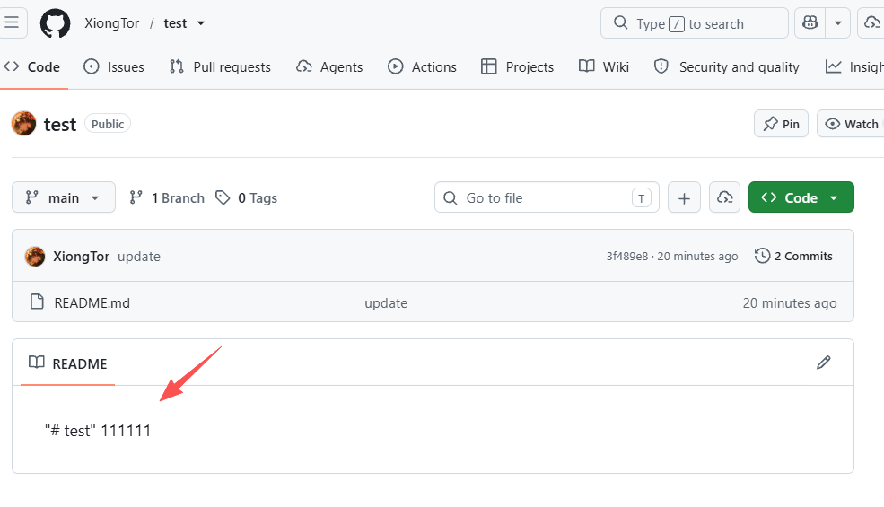
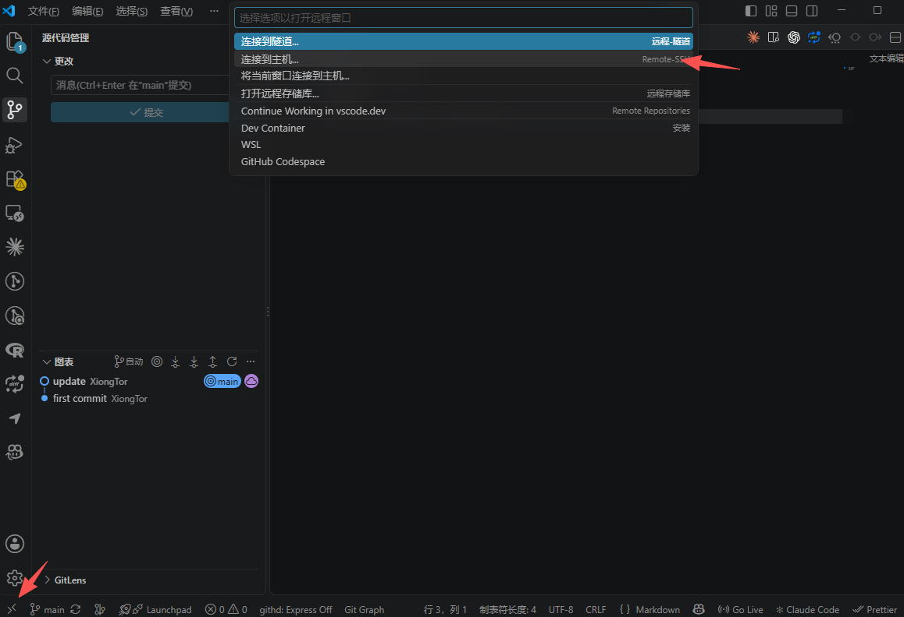
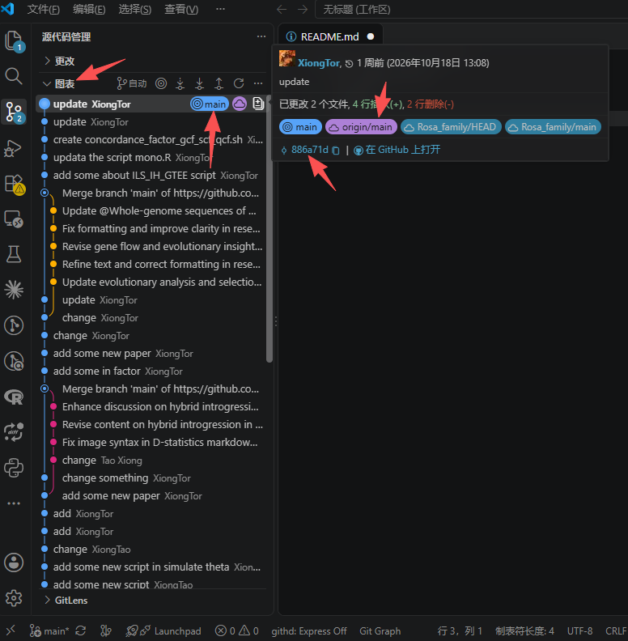
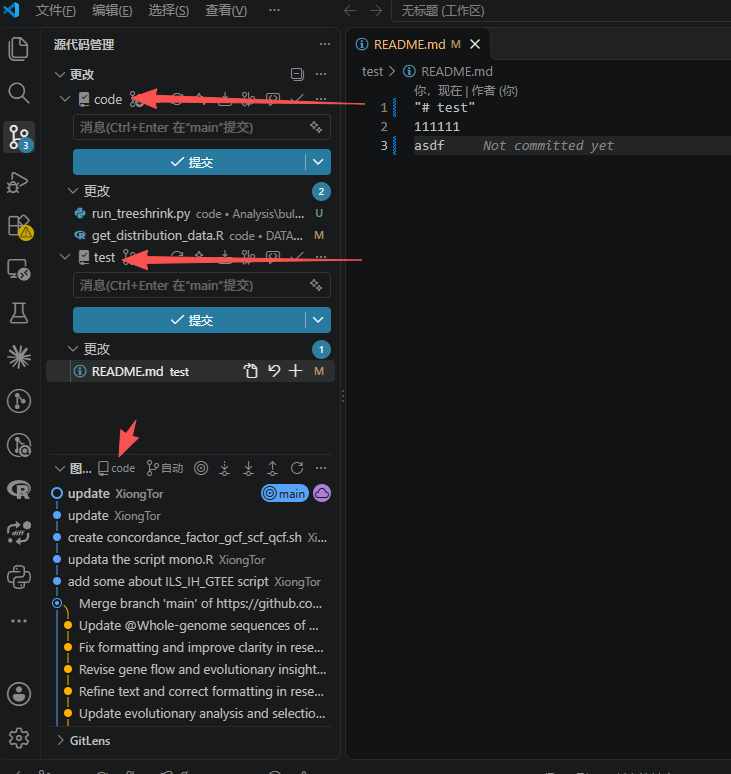
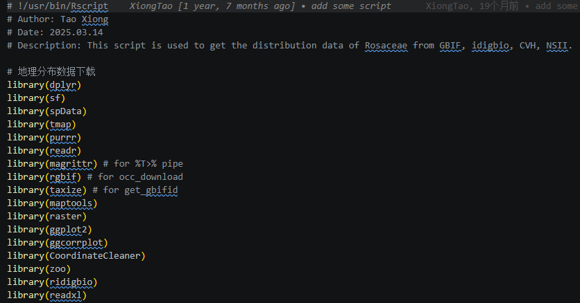

### 前言
需要安装的软件：
- `VS code` 方便日后进行代码管理，如果不喜欢可以不用，本地终端也支持本地仓库推送到GitHub
- `Git for Windows` 如果你电脑上从来没有用过Git的话，需要下载，现在大多数AI agent的前置程序，所以如果你安装了任何 AI agent，可能不需要安装这个

本流程仅仅作为一个非常简单的介绍，如果需要深度学习，可以自行在互联网上搜索更加详细的学习资料，git作为一个相当成熟的程序，学习资料数不胜数。

# 1. 如何快速将本地代码库上传到GitHub云端库中

如何链接上GitHub：
- 科学上网，会导致IP变动
- Watt Toolkit，本地加速器，IP基本不会变动，如果你需要进行GitHub学生认证，可以尝试使用这个保持你的IP不变动
- 直连，不进行任何操作，能否成功打开GitHub看运气
### （1）GitHub云端创建仓库，根据指引在本地初始化仓库，直接在终端运行即可

解释：
```
git init  # 本地初始化Git仓库
git add README.md  # 将文件放入暂存区，理论上初次配置后，后续推送前直接git commit就行，不需要再次git add，当然执行一次也没事
git commit -m "first commit"  # 将暂存区提交到本地仓库，这里可以认为记做了一次新的版本
git branch -M main  # 将当前分支强制重命名为 `main`；`-M` 表示即使目标分支名已存在，也允许强制重命名
git remote add origin https://github.com/XiongTor/test.git  # 添加一个名为 `origin` 的远程仓库，地址指向 GitHub 上的 `test` 仓库
git push -u origin main  # 将本地 `main` 分支推送到远程 `origin`
```

或者，使用AI agent执行，直接提供仓库地址，AI会完成全部步骤

本地仓库初始化并上传GitHub云端后，使用VS code打开本地对应的仓库地址（文件夹），之后可直接在VS code中打开并修改上传。




### （2）READMD.md文件与.gitignore文件
- READMD.md文件是最终显示在GitHub主页的文件，


- .gitignore 某些本地仓库中的敏感信息不想要推送到云端的时候，将对应文件的名称放置到`.gitignore`中就不会被推送到GitHub云端。最好在首次初始化仓库提交仓库的时候就写好，尤其是针对本地已有的代码库进行初始化的时候

# 2. 基于VS code的ssh连接，本地代码维护，日常使用

### (1) VS code 如何链接服务器
按照如下操作，连接后输入IP ，账户，密码即可正常连接登录


### （2）版本控制，本地库，云端库，版本号查看
在VS code如下位置可以查看，目前要上传的本地库到底是哪个分支（main），连接的云端库是哪个分支（origin/main），不同版本的版本号是多少（886a71d）


一般来讲，VS code会自动检测当前工作区对应的本地仓库和云端仓库，在不额外操作的情况下，会按照历史操作来进行推送
所以，如果工作区中放了多个库，就需要注意在推送的时候到底推送的是哪个库，防止推送错误，查看下图
当工作区中只有一个库时，一般不用担心这个问题



### （3）日常代码的书写格式------仅供参考，不一定标准
建议至少按照如下格式编写：
```
# !/usr/bin/Rscript ------ shebang，用于指定脚本的解释器，让系统知道用什么语言读你的脚本，也方便自己日后查看

# Author: Tao Xiong ------ 脚本作者

# Date: 2025.03.14 ------ 创造时间

# Description: This script is used to get the distribution data of Rosaceae from GBIF, idigbio, CVH, NSII. --- 解释一下这个脚本是用来干嘛的，最好写详细一点，这里写的比较简单

  

# 地理分布数据下载 --------- 开始写代码的时候，注意写好注释，哪怕用AI写，某些重要的关键代码，也最好让AI写好注释
```


# 3. GitHub云端如何操作
基本上，邀请协作者，更改仓库权限（公开还是私人）都在Setting中调节即可
如果想要在云端直接更改代码，直接编辑，点击键盘上的`.`会自动调出云端的VS code，方便你编辑，但目前测试，该功能似乎无法成功执行(2026.10.25)
