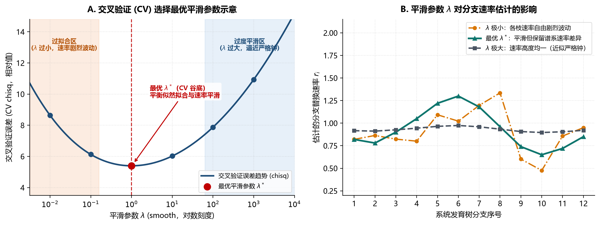
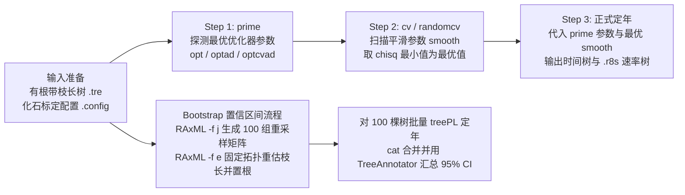

### 参考教程
[DeepWiki_treePL](https://deepwiki.com/blackrim/treePL/3.2-example-workflows)

### GitHub
[GitHub_treePL](https://github.com/sunray1/treepl)
### 自动化流程
[AUTO-MCMCTREE](https://github.com/SunLab-MiaoPu/PhyloerKit)

# 一、基本原理

## 1. 罚分似然法（Penalized Likelihood, PL）
treePL（Smith & O'Meara, 2012）是基于罚分似然框架开发的快速分子钟定年工具，专门用于处理大规模系统发育树（数百至数万个物种）。其核心思想是在泊松近似似然与相邻分支速率变化惩罚之间寻找平衡，最大化如下罚分目标函数：

$$\Psi = \ln L(t, r \mid b, N) - \lambda \cdot \Phi(r)$$

其中：
- $b$ 为输入分子树（phylogram）的枝长，$N$ 为建树所用的总位点数（`numsites`），两者乘积代表各枝的期望替换数；
- $\ln L$ 衡量当前节点时间 $t$ 与分支速率 $r$ 对观测枝长的拟合程度；
- $\Phi(r)$ 为速率粗糙度惩罚项（衡量父枝与子枝间速率差异，支持默认加法惩罚或 `log_pen` 对数惩罚）；
- $\lambda$ 为平滑参数（`smooth`），决定模型在“允许各枝自由变速”与“约束全树接近严格分子钟”之间的权衡。

## 2. 平滑参数选择与硬边界标定
- **交叉验证（Cross-Validation, CV）**：由于 $\lambda$ 无法直接通过最大似然估计，treePL 采用留一法（`cv`）或随机子采样（`randomcv`）逐次移除末端分支，用其余分支预测该分支长度并计算预测误差（`chisq`）。误差最低处对应的 $\lambda^*$ 即为最优平滑参数。
- **硬边界约束（Hard bounds）**：与 MCMCTree 的软边界不同，treePL 的化石标定（`min` / `max`）为严格硬边界，优化后的节点年龄绝不会越出设定区间。

# 二、标准分析流程

## 1. 输入文件与核心配置参数
- **有根带枝长树（`treefile`）**：必须为带有分子替换枝长的 Newick 树（通常由 RAxML / IQ-TREE 估算，或物种树重估枝长获得），且已正确置根。
- **配置文件（`*.config`）**：核心参数说明如下：

| 参数 | 示例 | 说明 |
| :--- | :--- | :--- |
| `treefile` / `outfile` | `input.tre` / `dated.tre` | 输入带枝长有根树路径；输出时间树路径（同时生成 `.r8s` 速率树） |
| `numsites` | `67367` | 用于估算枝长的比对总位点数 |
| `mrca` / `min` / `max` | `mrca = nodeA sp1 sp2` | 通过两个后代类群定义 MRCA，并用 `min` / `max` 设定年龄上下限（通常单位为 Ma） |
| `prime` | `prime` | 预测试各优化算法组合，输出推荐的 `opt`、`optad`、`optcvad` 等参数 |
| `cv` / `randomcv` | `cv` | 执行交叉验证；大树建议使用 `randomcv` 加速 |
| `cvstart` / `cvstop` / `cvmultstep` | `10000` / `0.001` / `0.1` | CV 扫描平滑参数的起止范围与倍增步长，结果写入 `cvoutfile` |
| `smooth` | `1` | 正式定年时填入 CV 找到的最优平滑参数 |
| `thorough` | `thorough` | 要求优化运行至收敛阈值，避免迭代过早终止 |
| `log_pen` | `log_pen` | 可选，切换为对数惩罚函数（替代默认加法惩罚） |
| `nthreads` | `8` | 并行线程数 |

## 2. 单树标准三步法与 Bootstrap 置信区间流程
- **单树定年（点估计）**：
  1. **Step 1（`prime`）**：配置文件开启 `prime` 和 `thorough`，运行 `treePL prime.cfg > prime.log 2>&1`，提取日志中 `PLACE THE LINES BELOW IN THE CONFIGURATION FILE` 之后的参数行。
  2. **Step 2（`cv`）**：将 `prime` 参数写入配置，注释 `prime` 并开启 `cv`（或 `randomcv`）与 `cvstart` / `cvstop` / `cvmultstep`，从 `cvoutfile` 中选取 `chisq` 最小的 `smooth`。
  3. **Step 3（正式定年）**：填入最优 `smooth` 与 `prime` 参数，去掉 `cv`，指定 `outfile` 运行，得到最终时间树和对应的 `.r8s` 分支速率树。
- **获取 95% 置信区间（CI）**：
  - 单次 treePL 不输出置信区间。发表级分析通常先用 `raxmlHPC -f j` 生成 100 组 bootstrap 比对，再用 `raxmlHPC -f e -t <固定拓扑>` 估算 100 棵枝长树并统一置根，随后对每棵树分别跑 treePL 定年，最后 `cat` 合并 100 棵时间树并用 `TreeAnnotator` 汇总各节点的 95% CI。

# 三、操作注意事项

1. **输入树枝长与拓扑检查**
   - 输入树必须带有分子替换枝长（与 MCMCTree 相反）且不能包含负枝长；极短枝或零长枝容易导致优化困难或局部速率异常，建树阶段应避免过度缺失数据或异常旁系同源序列拉长枝长。
   - 至少需要一个最大年龄约束（通常设在根节点）以锚定全树时间尺度，避免节点年龄无限漂移。

2. **正确把握 `prime` 与 `cv` 的顺序**
   - 官方文档（Stephen Smith / Maurin 2020）推荐 **`prime → cv → dating`**，使 `prime` 输出的 `optcvad` 与 `moredetailcvad` 在 CV 阶段即生效。部分课题组脚本采用 `cv → prime → dating`，在中小规模树上通常也能得到合理结果，但需确认 CV 曲线是否存在清晰的单一谷底。

3. **CV 搜索范围与细化验证**
   - 若最优 `smooth` 落在默认搜索区间（`1000`–`0.1`）的两端边界，说明真实最优点可能超出范围，必须外扩 `cvstart` 或缩小 `cvstop` 重跑；找到大致数量级后，可在谷底附近缩小步长（如 `cvmultstep = 0.5`）复核结果稳定性。

4. **警惕硬边界“顶死”与速率扭曲**
   - 定年完成后应逐一核对各标定节点的估算年龄：若根节点顶死 `max` 上限，或大量内部标定节点同时顶死 `min` 下限，说明部分化石约束与分子枝长存在张力或根上限过紧。应同时检查 `.r8s` 速率树中是否存在异常偏慢或偏快的分支，并做标定敏感性测试。

5. **配置关键字规范与日志留存**
   - 对数惩罚的原生关键字是 `log_pen`（而非 `log_p`），且 **CV 与正式定年必须保持惩罚模式一致**；非原生关键字（如 `date`、`primeoutfile`、`checkconstraints`）会被静默忽略。
   - 务必保存 `treePL` 原生屏幕输出日志以确认优化真正收敛；注意 `prime` 阶段会自动写出默认文件 `out_dates.tre`，后续分析切勿将其与最终 `outfile` 混淆。

6. **自动化脚本（`Auto_TreePL.py`）使用提醒**
   - 该脚本按 `cv → prime → date` 顺序运行，仅扫描默认 5 个粗粒度 `smooth` 点，且硬编码了 `date` / `log_p` 等非原生行；当 `prime` 仅输出 5 行参数时，其截取末尾 6 行的逻辑会把提示语 `PLACE THE LINES BELOW...` 一并写入最终配置文件。
   - 此外，该脚本仅对单棵树做点估计，不包含 Bootstrap 95% CI 计算；若用于正式论文发表，建议按标准三步法核查日志并补充 100 棵 Bootstrap 树汇总置信区间。
