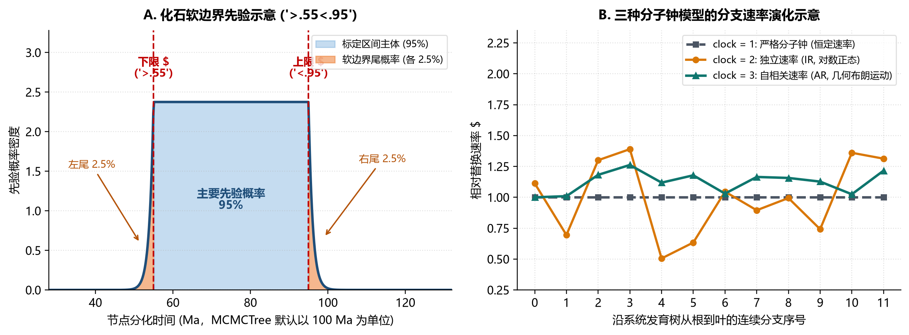
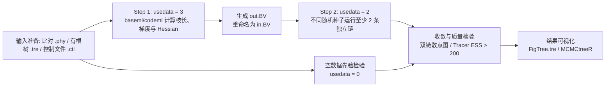
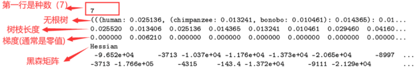

### 参考教程
[MCMCTree_tutorials](https://gensoft.pasteur.fr/docs/paml/4.9j/MCMCtree.Tutorials.pdf#:~:text=Compare%20the%20results%20obtained%20with%20the%20approximate,%E2%80%9Cout.%20txt%E2%80%9D%20file%20of%20each%20analysis)
[估算系统树分歧时间](https://yanzhongsino.github.io/2021/03/25/bioinfo_phylogeny_caculate.divergence.time/)

### 自动化参考
[AUTO-MCMCTREE](https://github.com/SunLab-MiaoPu/PhyloerKit)

# 一、基本原理

## 1. 分子钟定年的核心问题
多序列比对只能直接估计分支的遗传距离（即期望替换数 $b$），而遗传距离等于进化速率 (r)与时间 (t)的乘积：

$$b = r \times t$$

仅靠序列数据无法将分化时间 $t$ 与替换速率 $r$ 拆开。MCMCTree（PAML 软件包中的贝叶斯定年模块）在给定物种树拓扑的前提下，通过引入化石标定（或替换率先验）并在贝叶斯框架下利用 MCMC 抽样，联合估计各内部节点分化时间与分支速率的后验分布：

$$P(t, r \mid D) \propto P(D \mid t, r)\,P(t)\,P(r)$$

其中 $P(D \mid t, r)$ 为序列似然，$P(t)$ 为结合化石约束与出生-死亡过程（Birth-Death process）构建的时间先验，$P(r)$ 为分子钟速率先验。

## 2. 软边界化石标定与三种分子钟模型
- **软边界标定（Soft bounds）**：与严格截断的硬边界不同，MCMCTree 的化石区间（如 `'>.55<.95'` 或 `'B(.55, .95)'`）默认在上下限之外各保留约 2.5% 的概率尾。当化石记录存在误差或与分子数据轻度冲突时，模型仍允许后验时间以小概率越界，从而减轻标定偏差对全树的影响。未标定节点的时间先验由出生-死亡过程（`BDparas`）自动补全。
- **三种分子钟模型（`clock` 参数）**：
  - `clock = 1`（严格分子钟）：全树所有分支共享同一恒定速率。
  - `clock = 2`（独立速率模型，IR / ILN）：各分支速率彼此独立，服从同一对数正态分布，方差参数为 $\sigma^2$。
  - `clock = 3`（自相关速率模型，AR / GBM）：子枝速率继承自父枝速率，沿系统发育树呈几何布朗运动，对数速率方差与分支时间 $t$ 成正比（$t\sigma^2$）。



## 3. 近似似然加速原理（Approximate Likelihood）--- 跑MCMCTree的主要方法
对于大数据集，在每一步 MCMC 迭代中精确计算序列似然（`usedata = 1`）极其耗时。MCMCTree 推荐使用两步近似似然法（dos Reis & Yang, 2011）：
1. **第一步（`usedata = 3`）**：调用 `baseml`（核酸）或 `codeml`（蛋白/密码子），通过最大似然法一次性估计各分区的枝长、似然函数的一阶导数（gradient）与二阶导数矩阵（Hessian），合并保存为 `out.BV`。
2. **第二步（`usedata = 2`）**：将 `out.BV` 重命名为 `in.BV`，MCMC 过程中不再直接读取原始序列，而是基于 gradient 与 Hessian 通过泰勒展开近似计算似然，计算速度可提升百倍以上，且可兼容更复杂的替换模型（如 `GTR`、蛋白经验矩阵 `WAG` 等）。

# 二、标准分析流程（近似似然法）



## 1. 三个核心输入文件
- **序列文件（`*.phy`）**：需为 PHYLIP-relaxed 格式，物种名与序列之间至少间隔 2 个空格。若分多区（如按密码子 1/2/3 位点或不同基因），可将各分区 PHYLIP 区块纵向合并至同一文件，**区块数须与 `ndata` 对应**。
- **标定树文件（`*.tre`）**：首行写明 `物种数 树数`；第二行为**去除枝长与支持度**的有根 Newick 树，末尾必须带分号。时间单位默认且推荐设为 **100 Ma**（例如 6–8 Ma 写作 `'>.06<.08'`，最小 48.6 Ma 写作 `'>.486'`）。
- **控制文件（`mcmctree.ctl`）**：关键参数含义如下：
> 具体写法可以看看上述的参考教程中的写法

| 参数                                | 常用设置                       | 说明                                                               |
| :-------------------------------- | :------------------------- | :--------------------------------------------------------------- |
| `ndata` *重要                       | `1` / `3` / 分区数            | `.phy` 中按顺序读取的分区区块数                                              |
| `seqtype`                         | `0` / `1` / `2`            | `0`: 核酸；`1`: 密码子；`2`: 氨基酸                                        |
| `usedata` *重要                     | `0` / `1` / `2` / `3`      | `0`: 仅算先验；`1`: 精确似然；`2`: 近似似然（读 `in.BV`）；`3`: 生成 `out.BV`        |
| `clock`  *默认为2                    | `2` 或 `3`                  | `1`: 严格钟；`2`: 独立速率；`3`: 自相关速率                                    |
| `RootAge`                         | `'<1.0'` 等                 | 树根未加化石标定时生效的根年龄安全约束                                              |
| `model` / `alpha` / `ncatG`       | `4`（或 `7`）/ `0.5` / `5`    | 核酸模型：`4`=HKY85，`7`=GTR（仅 `usedata=3` 可用）；离散 Gamma 类别数            |
| `BDparas`                         | `1 1 0.1`                  | 出生率 $\lambda$、死亡率 $\mu$、取样比例 $\rho$（PAML 4.10 可加 `C` 启用条件构造）     |
| `rgene_gamma`                     | `2 20 1`                   | 基因平均速率的 Dirichlet-Gamma 先验（均值 $\alpha/\beta = 0.1$ 替换/位点/100 Ma） |
| `sigma2_gamma`                    | `1 10 1`                   | 速率异质性 $\sigma^2$ 的 Dirichlet-Gamma 先验（均值 $0.1$）                  |
| `burnin` / `sampfreq` / `nsample` | 如 `20000` / `10` / `20000` | 总迭代次数为 `burnin + sampfreq * nsample`                             |

## 2. 氨基酸与密码子数据的特殊处理 --- 一般不用了解，特殊情况可以查看
- **氨基酸数据（`seqtype = 2`）**：不支持 `usedata = 1`，必须使用近似似然法。`usedata = 3` 自动生成的 `tmp*.ctl` 默认采用最简单的 Poisson 模型且无 Gamma，需删除初始 `out.BV`，手动修改 `tmp*.ctl`（如改为 `model = 2`、指定 `aaRatefile = wag.dat` 并设 `fix_alpha = 0`、`ncatG = 4`），再运行 `codeml tmp*.ctl`，最后合并生成的 `rst2` 重命名为 `in.BV`。
- **密码子数据（`seqtype = 1`）**：开启 Gamma 时常报错，通常拆分为第 1/2/3 密码子位点 3 个核酸分区（`seqtype = 0, ndata = 3`）或翻译为氨基酸序列进行分析。


# 三. 代码流程示意

#### （1）使用流程开头介绍的AUTO-MCMCTREE

#### 注意事项
- `- ndata`参数的设置，一般情况下，你的`-fd`中包含了几个基因，这里ndata就要设置为对应的数量，否则最终运算不会使用全部的基因
- `- clock`参数的设置，这里没有设置，默认为2，如果你需要测试不同的分子钟，需要调整
- `- model`参数的设置，这里没有设置，默认为4，但是可以的话应该设置为7，特别是使用Approximate Likelihood方法
> 自动执行脚本完全遵循Approximate Likelihood方法，这是目前主流方法，如果希望尝试其它方法，可自行查看参考教程
```bash
python /home/xiongtao/data/software/PhyloerKit/src/Auto_MCMCTree.py \
  -it /data/xiongtao/project/Rosaceae/Rosaceae_fruit_type/02-final_astral_tree/06-timetree/mcmctree/rosaceae_sp_astral_pro3_rebranch_rt.tre \
  -ic /data/xiongtao/project/Rosaceae/Rosaceae_fruit_type/02-final_astral_tree/06-timetree/mcmctree/scheme1_xiang/scheme1_xiang.config \
  -fd /data/xiongtao/project/Rosaceae/Rosaceae_fruit_type/02-final_astral_tree/05-sortadate/gene_sortadate \
  -ndata 83 \
  -o /data/xiongtao/project/Rosaceae/Rosaceae_fruit_type/02-final_astral_tree/06-timetree/mcmctree/scheme1_xiang/result_ndata83 \
  -p Rosaceae_1 \
  --plot_tree
  
 # -it 带枝长的系统发育树
 # -ic config文件
 # -fd 所有基因序列的文件夹路径
```


#### （2）单独运行

准备下列所需文件
- **序列文件（`*.phy`）**
- **标定树文件（`*.tre`）**
- **控制文件（`mcmctree.ctl`）**

##### 标准流程 --- usedata=1
```bash
#  运行
mcmctree mcmctree.ctl

# R收敛性测试

# 创建数据
data <- read.csv("./MCMCtree_Convergence.csv")

# 绘制散点图
plot(data$run01, data$run02, pch = 15, col = as.numeric(sub("t_n", "", data$X)),
     xlim = c(0, max(data$run01)), ylim = c(0, max(data$run02)), #xlim和ylim参数分别设置x轴和y轴的范围
     xlab = "run01", ylab = "run02")

# 添加经过原点的线
abline(a = 0, b = 1, col = "black")

```

##### 快速流程 --- usedata=3/2  主流
```bash
# 打开配置文件，将usedate 设置为3
mcmctree mcmctree.ctl

# 新建文件夹，拷贝树，配置文件，比对文件以及out.BV到新文件夹 上一步得到out.BV中含有各个枝的长度，gradient和Hessian的值，将out.BV更改为in.BV. 再次更改配置文件usedata=2,可见下图参考
mkdir ../approx01  
cd ../approx01 
cp ../Hessian/mcmctree.ctl ../Hessian/Prunus.phylip ../Hessian/Prunus.tree ../Hessian/out.BV ./ 
mv out.BV in.BV  

mcmctree mcmctree.ctl


```



# 四、结果解读

1. **时间单位改变时必须同步缩放先验参数**
   - 官方推荐以 `100 Ma` 为时间单位。若改为 `1 Ma`（时间放大 $k = 100$ 倍），必须同步调整：
     - `RootAge` 与树中化石年龄均乘以 $k$；
     - `BDparas` 中的出生率与死亡率均除以 $k$（如 `1 1 0.1` 改为 `0.01 0.01 0.1`，取样比例不变）；
     - `rgene_gamma` 的 $\beta$ 乘以 $k$（如 `2 20 1` 改为 `2 2000 1`，Dirichlet 参数不变）；
     - `sigma2_gamma` 在 `clock = 2` 下保持不变，而在 `clock = 3` 下因方差为 $t\sigma^2$，其 $\beta$ 也必须乘以 $k$（如 `1 10 1` 改为 `1 1000 1`）。

2. **正确理解 `ndata` 与近似似然的耗时规律**
   - MCMCTree 严格按 `ndata` 从 `.phy` 文件头部读取对应数量的区块，不会自动检测实际区块数；若 `ndata` 小于实际区块数，后续基因会被静默忽略。--- ==重要，ndata必须设置对，否则实际运行的时候可能不会用到你输入的全部序列==
   - 在 `usedata = 2` 阶段，每步 MCMC 需对每个分区执行一次 $(2N-3)\times(2N-3)$ 的 Hessian 矩阵运算，因此**耗时主要随“分区数 × 物种数²”增长，几乎不受碱基总长度影响**。物种数较多（如上百个物种）时，建议按密码子位点或进化速率合并为 1–5 个大分区，避免设置几十上百个零碎短基因分区导致耗时剧增或短基因 Hessian 矩阵不稳定。

3. **近似似然法（`usedata = 2`）的适用限制与复用技巧**
   - **禁止与严格分子钟（`clock = 1`）联用**：严格钟下泰勒近似误差极大，结果不可靠。
   - 部分版本在 `usedata = 2` 行尾需保留 `*` 注释符（如 `usedata = 2 *`），避免读取空文件名报错。
   - 仅更换化石标定方案而拓扑与序列不变时，不同方案可共用同一份 `in.BV`，无需重复运行 `usedata = 3`。

4. **根节点必须存在约束**
   - MCMCTree 要求根节点必须有年龄约束；若树文件根节点未标定，则必须在 `.ctl` 中设置 `RootAge`；若树文件根节点已有标定，则优先采用树上标定（建议注释掉 `.ctl` 中冲突的 `RootAge` 以免混淆）。

5. **严格的收敛性检验与采样设置**
   - 必须使用不同随机种子（`seed = -1`）运行至少 2 条独立 MCMC 链，对比两链所有内部节点的后验均值散点图（点应紧密落在 $y = x$ 对角线上），并用 Tracer 检查 `mcmc.txt` 中各参数的 `ESS > 200`。
   - 运行时屏幕打印的参数接受比例应稳定在 20%–40%（15%–70% 可接受）；若前期波动明显，说明 `burnin` 不足。
   - 正常取样 `nsample` 保持在 10,000–20,000 即可；若未收敛，应优先增大 `burnin` 与 `sampfreq`，而非盲目堆高 `nsample`（否则极大增加输出体积与汇总耗时）。

6. **务必进行空数据先验检验（`usedata = 0`）**
   - 多个化石约束与出生-死亡过程交互后，实际生效的联合时间先验（effective prior）可能显著偏离原始化石设定。建议单独设置 `usedata = 0` 运行一次，对比先验与后验分布，确认分子数据确实推动了后验更新；另可绘制无限位点图（infinite-sites plot，即节点后验均值对 95% CI 宽度的散点图）评估增加序列长度对缩小置信区间的边际收益。

7. **自动化脚本（`Auto_MCMCTree.py`）使用提醒**
   - 使用 `-fd` 输入多基因 FASTA 目录时，脚本会将各基因转换为独立 PHYLIP 区块并纵向堆叠，且默认写入 `ndata = 5`（源码未实现自动检测区块数）。运行前必须显式指定与实际区块数一致的 `-ndata`，运行后核查 `*output0.txt` 中实际读取的 Locus 数与总位点数。
   - 脚本仅输出双链节点均值 $R^2$，建议额外补充 Tracer 的 ESS 检查及 `usedata = 0` 先验对比。


