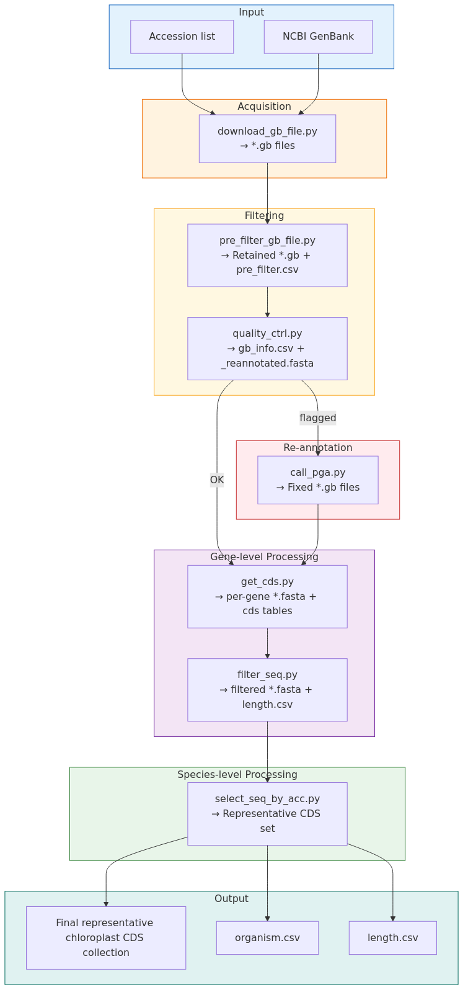

### Github
[PyNCBIminer_NG](https://github.com/wyx619/PyNCBIminer_NG) 最新版本，以下流程也是基于这个版本进行
[PyNCBIminer](https://github.com/Xiaoting-Xu/PyNCBIminer)
### 官方作者的论文中的相关流程图
下图为官方作者的一次交流中提供的参考流程图，最终结果并不一定以此为准，但以此为参考，制作了本次流程



# 一 . 直接使用图形化界面操作

# 二. 使用源码操作
本流程主要使用源码，主要是下载的数据量可能较大，不在windows的本地电脑上运行了

## 1. 下载源码并进行环境配置
```bash
## github仓库克隆
git clone https://github.com/wyx619/PyNCBIminer_NG.git /data/PyNCBIminer_NG

# 针对以下代码进行了重构，使得可以使用python直接调用，更新后的代码在服务器1的：/data/xiongtao/project/Rosaceae/Rosaceae_fruit_type/00-seqdata/04-chloroplast_pyNCBIminer/PyNCBIminer_NG/

  #  M src/Chloroplast/call_pga.py           +21 行（新增 __main__：-i/-g/-c/-r）
  #  M src/Chloroplast/download_gb_file.py   +18 行（新增 __main__：-i/-o/-e/-k/-t）
  #  M src/Chloroplast/pre_filter_gb_file.py +27 行（替换写死测试路径的 __main__：-i/-o/-n/--species_level）
  # ?? src/Chloroplast/search_accessions.py  新增（步骤 0 入口，内部调用 main_utils 的检索函数）
  
## Linux 环境配置，基于conda进行
conda create -n pyncbi python=3.12 -y
conda activate pyncbi

pip install -U pip
pip install "biopython>=1.78" "pandas>=2.0"
pip install "PySide6>=6.0" "PySide6-Fluent-Widgets"

```

## 2. 下载NCBI登录号
```bash
# 需要自己准备一个只包含物种名称的列表，参考格式：Prunus accumulans
python PyNCBIminer_NG/src/Chloroplast/search_accessions.py \
  -i ./Rosaceae_namelist.txt \
  -o ./ \
  -e 1760755795@qq.com \
  --chunk-size 200
    
# chunk-size，每一批次下载多少个，这里每一批次只下载200个，分多个批次进行，目的是防止NCBI崩坏导致全部的数据都无法拿到
```

## 3. 下载 GenBank
```bash
mkdir -p ./download

python PyNCBIminer_NG/src/Chloroplast/download_gb_file.py \
    -i ./accession_index.txt \
    -o ./download \
    -e 1760755795@qq.com \
    -t 15
```

## 4. 预过滤
```bash
mkdir -p ./prefiltered

cd PyNCBIminer_NG
  export PYTHONPATH=$PWD/src
  
python -m Chloroplast.pre_filter_gb_file \
      -i ../download -o ../prefiltered -n 3

# -n 每个 taxon 最多保留几条，默认 3
```

